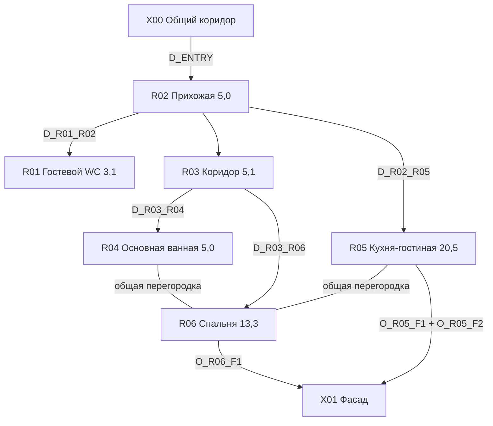

# Оцифрованная модель обмерного плана

Источник истины для дальнейшей работы: `plan-model.json`. Все размеры указаны в метрах. Ориентация всегда задаётся как **верх/низ/лево/право плана**, а не как «слева в кадре».

## Идентификаторы помещений

| ID | Помещение | Площадь | Рабочий габарит | Положение на плане | Уверенность |
|---|---|---:|---:|---|---|
| R01 | Гостевой санузел / постирочная | 3,1 м² | 1,98 × 1,55 | верх слева | средняя |
| R02 | Прихожая | 5,0 м² | основная часть 2,17 × 2,02 + ниши | верх, левее центра | средняя |
| R03 | Коридор | 5,1 м² | 2,685 × 1,89 | верх по центру | высокая |
| R04 | Основная ванная | 5,0 м² | 2,65 × 1,88 | верх справа | средняя |
| R05 | Кухня-гостиная | 20,5 м² | максимум 5,90 × 3,57 | низ слева | высокая |
| R06 | Спальня | 13,3 м² | 3,69 × 3,56 | низ справа | средняя |
| X00 | Общая сторона входа | — | — | над прихожей | средняя |
| X01 | Фасадная сторона с остеклением | — | — | низ плана | высокая |
| X02 | Неидентифицированная зона | 2,9 м² | не установлено | вне контура сверху слева | низкая |

Высота потолка: **3,20 м**, подтверждено пользователем. Ещё нужно уточнить, это высота от плиты до плиты или готовая чистовая высота.

## Главные размерные связи

### Кухня-гостиная R05

- Общая ширина по фасаду: **5,90**.
- Максимальная глубина по план-левой кухонной стене: **3,57**.
- Кухня **Г-образная**: длинное плечо располагается вдоль левой стены плана, короткое плечо поворачивает по верхней стене под гостевым санузлом.
- Короткая стена за кухней / возвратное плечо: ориентировочно **1,72**.
- Перегородка со спальней: рабочая длина **3,56**, отмеченная толщина около **0,125**.
- На нижней фасадной стене два проёма в порядке от левого края плана:
  1. `O_R05_F1` — ориентировочно **1,49**, более узкий;
  2. `O_R05_F2` — ориентировочно **2,19**, более широкий.
- Для ракурса из верхней части плана к фасаду кухня должна оказаться **справа в изображении**, а перегородка спальни — слева.

### Спальня R06

- Рабочая ширина: **3,69**.
- Рабочая глубина: **3,56**.
- На правой наружной стене также подписано **3,425**; значение конфликтует с основной глубиной и пока хранится как отдельный сырой замер.
- Нижний фасадный проём `O_R06_F1`: **2,25**.
- Возле него читаются простенки около **0,71** и **0,73**, но их точки отсчёта требуют подтверждения.
- Свободный верхний участок стены справа от входа: около **1,87**.

### Коридор R03

- Ширина по верхней стене: **2,685**.
- Рабочая глубина: около **1,89**.
- Соединяет прихожую R02, ванную R04, спальню R06 и зону кухни-гостиной R05.

### Основная ванная R04

- Рабочий габарит: **2,65 × 1,88**.
- Дверной проём со стороны коридора: ориентировочно **0,89**.
- На нижней размерной цепочке читаются фрагменты **1,00**, **1,87** и **0,80**; точные точки отсчёта на фото неоднозначны.

### Гостевой санузел R01

- Рабочий габарит: **1,98 × 1,55**.
- Проверка площади: 1,98 × 1,55 = 3,069 м², что согласуется с печатными 3,1 м².
- Существующая ниша относится к постирочной функции; точную ширину и глубину ниши по фото надёжно считать нельзя.

### Прихожая R02

- Основная часть: примерно **2,17 × 2,02**, но помещение нерегулярное и включает дополнительные ниши.
- Входной проём на верхней стороне: ориентировочно **1,06**.
- На примыкающих цепочках читаются **1,335**, **1,415**, **0,80**, **0,63** и **0,23**; они сохранены в JSON как сырые фрагменты низкой уверенности.

## Проёмы

| ID | Связь | Тип | Ширина | Уверенность |
|---|---|---|---:|---|
| D_ENTRY | X00 ↔ R02 | входная дверь | 1,06 | средняя |
| D_R01_R02 | R01 ↔ R02 | дверь санузла | 0,80 | низкая |
| D_R02_R05 | R02 ↔ R05 | дверь/проём | 0,80 | низкая |
| D_R03_R04 | R03 ↔ R04 | дверь ванной | 0,89 | средняя |
| D_R03_R06 | R03 ↔ R06 | дверь спальни | 0,89 | средняя |
| O_R05_F1 | R05 ↔ X01 | узкий фасадный проём | 1,49 | средняя |
| O_R05_F2 | R05 ↔ X01 | широкий фасадный проём | 2,19 | средняя |
| O_R06_F1 | R06 ↔ X01 | фасадный проём спальни | 2,25 | высокая |

Высоты, типы заполнения, направление открывания и отметки подоконников фасадных проёмов на фотографии не установлены. Визуализации не должны самовольно превращать их в окна или панорамные двери конкретного типа.

## Сырые короткие размеры

На фото читаются короткие фрагменты **0,14; 0,23; 0,44; 0,63; 0,65; 0,67; 0,69; 0,75; 0,80; 0,89; 1,00; 1,335; 1,415; 1,72; 1,78; 1,87; 1,90**. Размер **1,72** связан со стеной за коротким плечом Г-образной кухни; остальные спорные фрагменты сохранены в `measurement_register`. До контрольного обмера значения низкой уверенности нельзя использовать для заказа мебели, стекла, дверей или сантехнических перегородок.

## Граф связей

## Арифметическая проверка

| Помещение | Проверка прямоугольником | Печатная площадь | Вывод |
|---|---:|---:|---|
| R01 | 1,98 × 1,55 = 3,069 | 3,1 | совпадает |
| R03 | 2,685 × 1,89 = 5,075 | 5,1 | совпадает |
| R04 | 2,65 × 1,88 = 4,982 | 5,0 | совпадает |
| R05 | 5,90 × 3,57 = 21,063 | 20,5 | разница объясняется верхними нишами |
| R06 | 3,69 × 3,56 = 13,136 | 13,3 | близко, нужна чистовая съёмка |

## Что нужно перемерить в первую очередь

1. Все фасадные проёмы: ширина, высота, подоконник, откосы и радиаторы.
2. Точная длина кухонной стены R05 после штукатурки.
3. Правая стена спальни и конфликт значений 3,56/3,425.
4. Ниша стиральной машины в R01.
5. Точные дверные проёмы и толщины перегородок.
6. Координаты стояков, вентиляции и канализационных выпусков.
7. Чистовая высота потолка после пола и потолочной конструкции.

## Правила дальнейшей работы

- Все новые решения ссылать на ID помещения, стены или проёма.
- Не использовать слова «слева/справа» без уточнения «на плане» либо направления камеры.
- Значения `low` не использовать для изготовления и закупки.
- При получении нового замера менять JSON, затем синхронизировать таблицу и визуализации.
- Генеративный рендер не считать проверкой геометрии.
